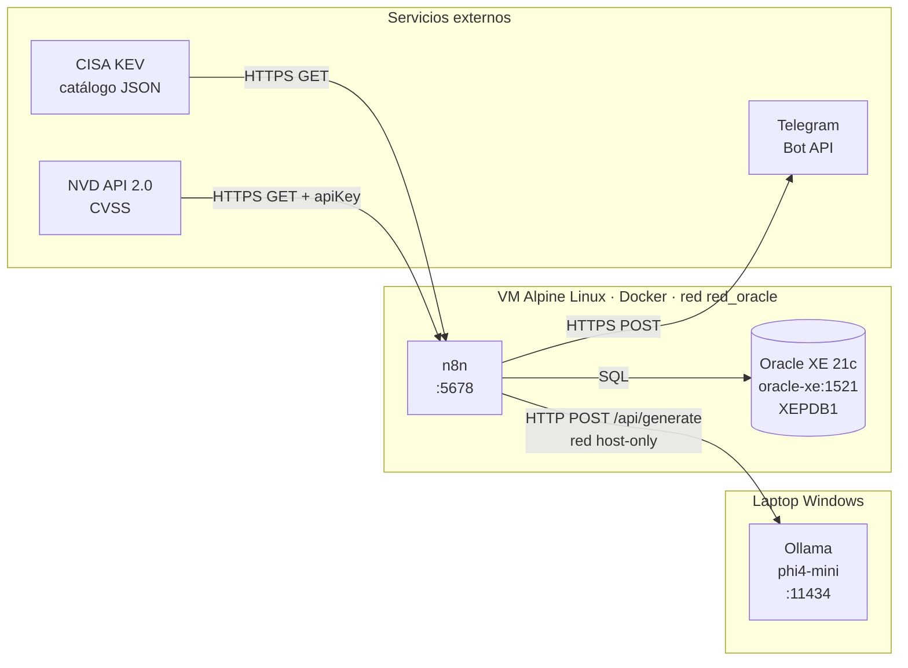
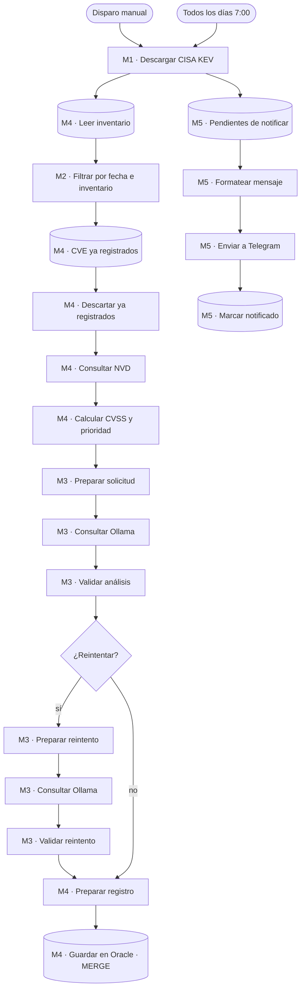
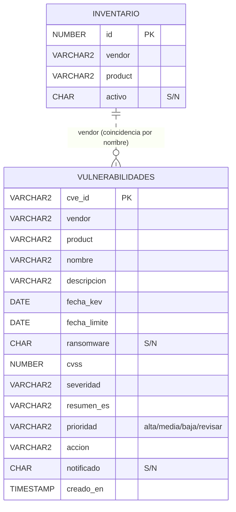

# Monitor de vulnerabilidades con IA

Sistema automatizado que cada mañana descarga las vulnerabilidades que se están **explotando activamente** en el mundo (catálogo **CISA KEV**), se queda solo con las que afectan al **inventario tecnológico** de una organización, consulta su gravedad (**CVSS**) en **NVD**, decide la prioridad con **reglas fijas**, usa un **LLM local** (Ollama) para explicarlas en español con una acción concreta, las guarda en **Oracle** sin duplicados y envía las urgentes por **Telegram**.

> De cientos de CVE publicados al día a una o dos alertas que alguien puede ejecutar antes del almuerzo.

    

---

## Contenido

- [El problema](#el-problema)
- [Caso de uso](#caso-de-uso)
- [Arquitectura](#arquitectura)
- [Flujo de trabajo en n8n](#flujo-de-trabajo-en-n8n)
- [Decisiones de diseño](#decisiones-de-diseño)
- [Ejemplo de alerta](#ejemplo-de-alerta)
- [Estructura del repositorio](#estructura-del-repositorio)
- [Puesta en marcha](#puesta-en-marcha)
- [Modelo de datos](#modelo-de-datos)
- [Manejo de errores](#manejo-de-errores)
- [Pruebas](#pruebas)
- [Resultados y aprendizajes](#resultados-y-aprendizajes)
- [Limitaciones conocidas](#limitaciones-conocidas)
- [Hoja de ruta](#hoja-de-ruta)

---

## El problema

Cada día se publican cientos de CVE nuevos. Una organización pequeña, con una sola persona a cargo de sistemas, no puede leer los boletines de seguridad (casi todos en inglés) ni saber cuáles la afectan. El riesgo real no está en "todas las vulnerabilidades", sino en las que **ya se están explotando** y tocan **su tecnología**.

## Caso de uso

Una clínica en Bogotá con 40 empleados y un solo encargado de sistemas. Usa un firewall **Fortinet**, **Windows Server** y una web con **Apache**.

1. CISA agrega a su catálogo una vulnerabilidad de FortiOS que grupos de ransomware ya están explotando.
2. A las 7:00 a. m. el sistema la detecta, ve que Fortinet está en el inventario y consulta su CVSS en NVD.
3. Las reglas la marcan como **alta**, y el LLM local la explica en español con una acción concreta.
4. Se guarda en Oracle y llega a Telegram.
5. Las vulnerabilidades de la semana que no afectan a la clínica **nunca generan ruido**.

---

## Arquitectura



**Patrón:** pedir → filtrar → enriquecer → entender → guardar → avisar.

| Componente | Dónde corre | Por qué |
|---|---|---|
| **n8n** | VM, contenedor Docker | Orquesta todo el flujo; comparte red con Oracle y lo alcanza por nombre de contenedor |
| **Oracle XE 21c** | VM, contenedor `oracle-xe` | Memoria del sistema: inventario, historial y estado de notificación |
| **Ollama + phi4-mini** | Laptop, nativo | Usa toda la RAM y CPU del equipo; los datos no salen de la organización |
| **CISA KEV, NVD, Telegram** | Servicios externos | APIs públicas y gratuitas. No se expone nada a Internet: Telegram solo se usa para *enviar* |

---

## Flujo de trabajo en n8n

El workflow tiene 22 nodos organizados en dos ramas que salen del recolector:



- **Rama principal (arriba):** procesa solo lo nuevo y lo guarda.
- **Rama de aviso (abajo):** n8n la ejecuta **después** de terminar la rama principal (orden de ejecución v1, por posición vertical). Envía todo lo que esté pendiente, aunque ese día no haya vulnerabilidades nuevas.

| Módulo | Qué hace | Tecnología |
|---|---|---|
| **1. Recolector** | Descarga el catálogo completo de CISA KEV (~1.780 entradas) | Schedule Trigger + HTTP Request |
| **2. Filtro** | Deja solo lo agregado en los últimos N días que coincide con el inventario | Code (JavaScript) |
| **3. Analista IA** | Redacta en español un resumen y una acción; valida la respuesta y reintenta una vez | HTTP Request → Ollama + Code |
| **4. Memoria** | Lee el inventario, descarta lo ya guardado, obtiene el CVSS, aplica las reglas de prioridad y guarda con `MERGE` | Oracle Database + HTTP Request → NVD + Code |
| **5. Notificador** | Envía las alertas `alta` y `revisar` pendientes y las marca como notificadas | Oracle + Code + Telegram |

---

## Decisiones de diseño

### 1. La prioridad la deciden reglas, no la IA

| Condición | Prioridad | ¿Se notifica? |
|---|---|---|
| Usada en campañas de ransomware **o** CVSS ≥ 9 | 🔴 **alta** | Sí |
| CVSS entre 7 y 8.9 | 🟠 media | No (queda registrada) |
| CVSS < 7 | 🟢 baja | No (queda registrada) |
| NVD aún no tiene CVSS y no hay ransomware | ⚪ **revisar** | Sí, porque ya se está explotando |

En la v3 el modelo decidía la prioridad y marcaba **todo como alta**, incluso fugas de información o caídas del servicio con CVSS de 6.5 a 8.6. Desde la v4 **las reglas deciden y el LLM explica**. El resultado es predecible y auditable, y cada prioridad se puede justificar.

### 2. LLM local

Ollama corre en la red local, así que no hay costo por uso ni cuotas, y los datos del inventario no salen de la organización. Se usa `format: "json"` para forzar JSON válido y `temperature: 0` para que la misma entrada dé siempre la misma salida. Se comparó con `llama3.2:3b`, que se descartó porque inventaba impactos.

### 3. El código de los nodos vive en el repositorio

El JavaScript de los nodos Code está en `n8n/code/` y las consultas SQL en `sql/n8n/`. El script `scripts/construir_workflow.js` los incrusta en el workflow importable. Así, lo que se prueba es exactamente lo que corre en n8n, el historial de cambios queda en git y el JSON nunca lleva credenciales.

### 4. Idempotencia

Ejecutar el flujo dos veces el mismo día no duplica datos ni avisos. Los CVE ya guardados se descartan antes de consultar NVD y la IA, y además el `MERGE` impide insertar dos veces el mismo CVE. Cada alerta se marca como notificada solo **después** de enviarla.

---

## Ejemplo de alerta

```
🔴 PRIORIDAD ALTA — CVE-2026-109618
Producto: PHP Group PHP  |  CVSS 9.8  |  Ransomware: no
Qué pasa: <resumen en español generado por phi4-mini>
Qué hacer: <acción concreta con plazo, generada por phi4-mini>
Fecha límite CISA: <dueDate del catálogo>
```

Ejemplos reales de texto generado (CVE-2026-20320, Cisco BroadWorks, CVSS 7.5, prioridad media):

> **Qué pasa:** Permite a un atacante leer información sensible de la configuración del sistema.
> **Qué hacer:** Durante esta semana, verificar si el producto Cisco BroadWorks está instalado y expuesto a Internet, y aplicar el parche de seguridad si está disponible.

---

## Estructura del repositorio

```
monitor-vulnerabilidades/
├── README.md
├── docker-compose.yml            # n8n unido a la red Docker de Oracle
├── package.json                  # npm test (pruebas del código de los nodos)
├── requirements.txt              # entorno Python del notebook
├── .env.example                  # plantilla de variables (sin valores reales)
├── workflows/
│   └── monitor_vulnerabilidades.json   # workflow importable, generado y sin secretos
├── n8n/code/                     # JavaScript de cada nodo Code (fuente de verdad)
│   ├── 02_filtro_kev.js
│   ├── 03_preparar_solicitud.js
│   ├── 03_validar_analisis.js
│   ├── 04_descartar_registrados.js
│   ├── 04_cvss_prioridad.js
│   ├── 04_preparar_registro.js
│   └── 05_formato_telegram.js
├── sql/
│   ├── 00_usuario.sql            # usuario propio del proyecto (no SYSTEM)
│   ├── 01_tablas.sql             # tablas e inventario inicial
│   ├── 02_consultas.sql          # consultas de análisis
│   └── n8n/                      # una consulta por nodo Oracle del workflow
├── scripts/
│   └── construir_workflow.js     # genera el workflow desde n8n/code y sql/n8n
├── tests/                        # 91 pruebas con node:test + fixtures reales
├── prompts/
│   └── analista.md               # prompt, criterios de validación y registro de pruebas
├── notebooks/
│   └── analisis_kev.ipynb        # análisis del catálogo KEV con pandas
└── docs/                         # diagramas y capturas
```

---

## Puesta en marcha

### Requisitos

- VM con Docker, con Oracle XE ya corriendo en un contenedor.
- Laptop con [Ollama](https://ollama.com) y el modelo `phi4-mini` (`ollama pull phi4-mini`).
- Node.js ≥ 20 (para las pruebas y para generar el workflow) y Python 3 (para el notebook).
- Una API key gratuita de [NVD](https://nvd.nist.gov/developers/request-an-api-key) y un bot de Telegram creado con @BotFather.

### 1. Red Docker y n8n (en la VM)

```bash
docker network create red_oracle
docker network connect red_oracle oracle-xe
docker compose up -d
```

En una red **definida por el usuario**, los contenedores se encuentran por nombre: n8n llega a Oracle como `oracle-xe:1521`.

### 2. Ollama accesible desde la VM (en el laptop)

- Variable de entorno `OLLAMA_HOST=0.0.0.0` y reiniciar Ollama por completo.
- Regla de firewall de entrada para el puerto `11434` **limitada a la red de la VM**.
- Verificar desde la VM: `docker exec n8n wget -qO- http://<IP_HOST_ONLY_DEL_LAPTOP>:11434/api/tags`.
- La URL de Ollama se configura en `scripts/construir_workflow.js` (`OLLAMA_URL`).

### 3. Base de datos (una sola vez)

1. Como `SYSTEM` en `XEPDB1`: ejecutar `sql/00_usuario.sql` después de cambiar la contraseña.
2. Como `monitor`: ejecutar `sql/01_tablas.sql`.
3. El inventario se administra en la tabla `INVENTARIO`, usando el **nombre del fabricante tal como lo escribe CISA**:

```sql
INSERT INTO inventario (vendor, product) VALUES ('PHP Group', 'PHP');
UPDATE inventario SET activo = 'N' WHERE vendor = 'Apache';  -- desactivar sin borrar
COMMIT;
```

### 4. Generar e importar el workflow

```bash
node scripts/construir_workflow.js
```

En n8n, usa *Workflows → Import from file* → `workflows/monitor_vulnerabilidades.json`. Luego elige las credenciales:

| Nodos | Credencial |
|---|---|
| Los 5 nodos Oracle | *Oracle Database*: usuario `monitor`, host `oracle-xe`, puerto `1521`, servicio `XEPDB1` |
| M4 · Consultar NVD | *Header Auth*: **Name** `apiKey` (sin espacios) y **Value** la llave |
| M5 · Enviar a Telegram | *Telegram API* y el `chat_id` |

Por último, activa el workflow para que corra todos los días a las 7:00 (`America/Bogota`).

### 5. Notebook de análisis (opcional)

```bash
py -m venv .venv
.venv\Scripts\activate
pip install -r requirements.txt
jupyter lab notebooks/
```

### Secretos

Los tokens y llaves viven **solo en Credentials de n8n**. El archivo `.env` está en `.gitignore`. El workflow se genera desde el código, nunca se exporta directo de n8n, así que no lleva credenciales ni `chat_id`.

---

## Modelo de datos



Consultas útiles (`sql/02_consultas.sql`):

```sql
-- Vulnerabilidades críticas vigentes por proveedor
SELECT vendor, COUNT(*) AS total
FROM vulnerabilidades
WHERE prioridad = 'alta' AND fecha_limite >= SYSDATE
GROUP BY vendor ORDER BY total DESC;
```

---

## Manejo de errores

| Situación | Manejo |
|---|---|
| NVD responde 429 (límite de solicitudes) | Una solicitud cada 700 ms con API key; hasta 3 intentos separados 6 s; si aun así falla, CVSS vacío y prioridad `revisar` |
| NVD aún no tiene CVSS | Se usa el CVSS del fabricante (`Secondary`) si existe; si no, prioridad `revisar` (se notifica) |
| Credencial de NVD mal escrita | El diagnóstico muestra el código real (p. ej. `ERR_INVALID_HTTP_TOKEN`) en el campo `motivoSinCvss` |
| El LLM devuelve JSON inválido o una acción incompleta | Validación, 1 reintento; si vuelve a fallar se guarda sin resumen, el mensaje usa la descripción de CISA y la prioridad por reglas no cambia |
| Ollama apagado o tarda más de 300 s | El nodo HTTP continúa con `{ error }` y sigue el mismo camino que el JSON inválido |
| CVE ya existe en Oracle | Se descarta antes de NVD y de la IA; además el `MERGE` evita el duplicado |
| Telegram falla | La alerta queda con `notificado = 'N'` y se reenvía en la próxima ejecución |
| Tabla `INVENTARIO` vacía | El flujo se detiene con error en lugar de "funcionar" sin avisar nada |
| Texto más largo que la columna | Se recorta contando bytes UTF-8 antes de guardar (evita ORA-12899) |

---

## Pruebas

```bash
npm test
```

Son 91 pruebas con `node:test` (sin dependencias externas). Cubren el filtro, las reglas de prioridad en sus límites exactos (6.9 / 7.0 / 8.9 / 9.0), la extracción de CVSS de una **respuesta real de NVD**, cada motivo de rechazo de la respuesta del LLM, el recorte por bytes con tildes y emojis, y el formato de los mensajes.

Cada archivo de `n8n/code/` funciona tal cual dentro de n8n (usa `$input`) y también se puede importar en Node para probarlo.

---

## Resultados y aprendizajes

| Hallazgo | Qué se hizo |
|---|---|
| El LLM de 3–4B sobrestimaba la urgencia: marcó 3 de 3 como alta | La prioridad pasó a reglas fijas con CVSS; el LLM solo redacta |
| Al dar los plazos como palabras sueltas, el LLM respondió `accion = "revisar"` | Prompt con un ejemplo de acción completa y una validación de al menos 3 palabras |
| `llama3.2:3b` inventaba impactos ("tomar el control") | Se mantuvo `phi4-mini` |
| En CVE recientes, NVD solo tiene el CVSS del fabricante (`Secondary`) | El extractor prefiere `Primary` y si no hay usa `Secondary` |
| Las alertas pendientes solo se reenviaban si había vulnerabilidades nuevas | La rama de aviso se independizó y corre en cada ejecución |
| Oracle mide `VARCHAR2` en bytes y las tildes ocupan 2 | El recorte de textos cuenta bytes UTF-8 |

Detalle completo de las pruebas del prompt en [`prompts/analista.md`](prompts/analista.md).

---

## Limitaciones conocidas

- Si el laptop (Ollama) o la VM están apagados a las 7:00 a. m., el flujo no corre. Es un montaje local, no un servicio en alta disponibilidad.
- La coincidencia con el inventario es por **fabricante**, no por versión: avisa de lo que *podría* afectar a la organización.
- Dos ejecuciones simultáneas (manual y programada) pueden chocar en el `MERGE` (ORA-00001). La siguiente ejecución lo corrige.
- En CPU, Ollama tarda entre 10 y 30 s por vulnerabilidad.

## Hoja de ruta

| Versión | Qué agrega | Estado |
|---|---|---|
| v0 | Recolector de CISA KEV | ✅ |
| v1 | Filtro por fecha e inventario en JavaScript | ✅ |
| v2 | Notificación por Telegram | ✅ |
| v3 | Analista IA local con validación y reintento | ✅ |
| v4 | Oracle, NVD (CVSS), inventario en tabla, prioridad por reglas y rama de aviso independiente | ✅ |
| v5 | Webhook + agente de IA con herramienta SQL ("¿qué vulnerabilidades críticas de Cisco hubo esta semana?") | ⬜ |
| Extra | *Error Workflow* que avise por Telegram si el flujo falla; respaldo con Gemini si Ollama no responde | ⬜ |

---

## Referencias

- [CISA — Known Exploited Vulnerabilities Catalog](https://www.cisa.gov/known-exploited-vulnerabilities-catalog)
- [NVD — API de vulnerabilidades 2.0](https://nvd.nist.gov/developers/vulnerabilities)
- [n8n — documentación](https://docs.n8n.io/)
- [Ollama — API](https://github.com/ollama/ollama/blob/main/docs/api.md)
- [Telegram Bot API](https://core.telegram.org/bots/api)
- [FIRST — Especificación CVSS](https://www.first.org/cvss/)
